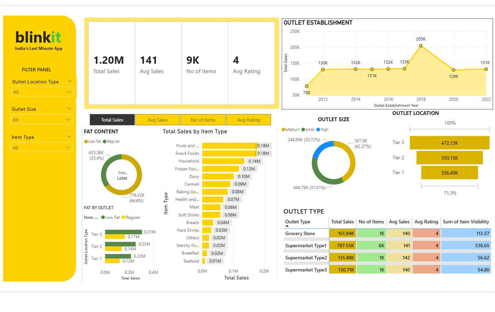

# BlinkIT Grocery Sales Dashboard

A one-page Power BI dashboard analysing grocery sales across 10 outlets. I built it myself following the "Amazing Real Time Power BI Project" walkthrough from the Data Tutorials YouTube channel (https://youtu.be/mmxVCFceQgU), using the practice dataset (8,523 rows) that the tutorial shares with its viewers.

Credit: Data Tutorials (YouTube) for the walkthrough and the dataset.

## Preview



## Dashboard contents

- KPI cards: total sales, average sales per item, average rating, number of items
- Donut charts: sales by item fat content and by outlet size
- Bar charts: fat content by outlet and total sales by item type
- Line chart: sales by outlet establishment year
- Funnel: sales by outlet location tier
- Table: outlet type breakdown
- Filter panel: slicers for outlet size, location tier and item type

## Key numbers

Computed by the companion script below against the dataset:

- Total sales: 1,201,681.49 across 8,523 item-outlet rows
- Average sales per item: 140.99; average rating: 3.97
- 1,559 unique item identifiers across 10 outlets
- Top item types by sales: Fruits and Vegetables (178,124), Snack Foods (175,434), Household (135,977)
- Tier 3 locations lead on sales (472,133), ahead of Tier 2 (393,151) and Tier 1 (336,398)
- Medium-size outlets contribute the most sales (507,896)

## Files

- `BlinkIT-Grocery-Dashboard.pbix` - my Power BI report (open in Power BI Desktop)
- `blinkit_eda.py` - companion pandas analysis added when this repo was published; not part of the tutorial or the original dashboard
- `dashboard-preview.jpg` - screenshot of the rendered dashboard

## Dataset

The standalone XLSX is not included in this repo. The Power BI report contains an embedded copy of the dataset; to run the Python script, download "BlinkIT Grocery Data.xlsx" from the tutorial's data folder (https://drive.google.com/drive/folders/1mKh61zKVBnPJN0A5lc77osGNkmNa-loI?usp=sharing) and place it next to the script.

## Run the companion script

```
pip install pandas openpyxl
python blinkit_eda.py
```

## Tools

Power BI Desktop, Python (pandas)
